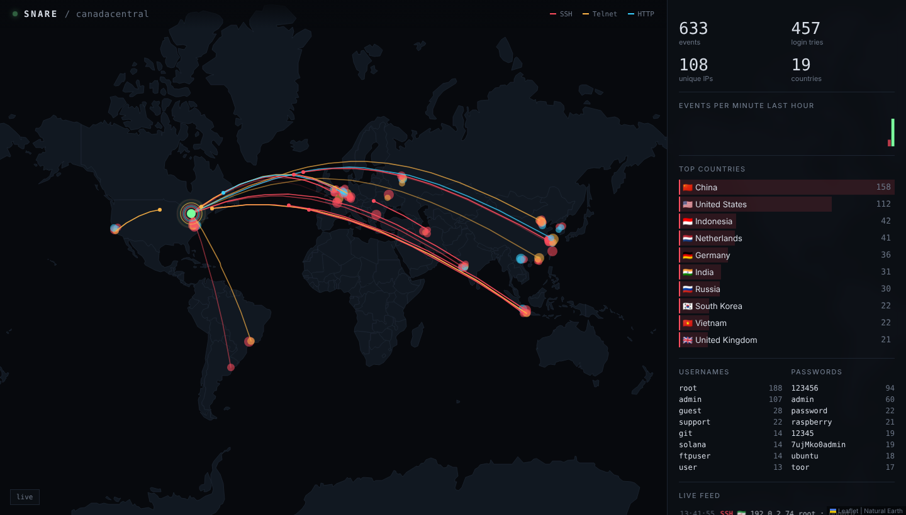
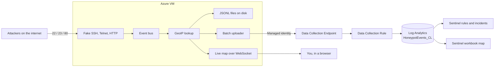

# Snare

A cloud honeypot with a live threat map.

Snare runs fake SSH, Telnet, and web login services on an Azure VM. Bots
find it within minutes and start guessing passwords. Every attempt is
logged, tagged with where it came from, sent to Azure Log Analytics and
Microsoft Sentinel, and drawn on a live world map as it happens.

Nothing ever logs in. There is no shell behind any of the fake services.



## What it does

- **Three fake services.** SSH on port 22 (real SSH protocol, so bots act
  normally), Telnet on 23 (where Mirai style IoT bots live), and a router
  style web login on 80.
- **Logs every attempt.** Source IP, username, password, SSH client
  version, web path, and user agent.
- **Finds the location.** Country, city, coordinates, and ASN, using an
  offline MaxMind GeoLite2 database or the free ip-api.com service.
- **Live map.** A web page that draws an arc from each attacker to the
  honeypot the moment they connect, with top countries, usernames, and
  passwords beside it.
- **Ships to Azure.** Events go to a custom `HoneypotEvents_CL` table
  through the Logs Ingestion API, using the VM's managed identity. No keys
  or secrets on the box.
- **Sentinel detections.** Four analytics rules that raise incidents for
  brute force, password spraying, multi protocol scanning, and web
  exploit probes, each mapped to MITRE ATT&CK.
- **Sentinel workbook.** A map and tables over the full history.
- **All of it in Terraform.** One `terraform apply` builds the VM,
  network, Log Analytics, Sentinel, the ingestion pipeline, the rules, and
  the workbook.

## How it fits together



The real admin SSH moves to port 22022 and only accepts your IP and your
key, so the honeypot can own port 22.

## Try it locally in one minute

You do not need Azure for this part.

```bash
pip install -e ".[dev]"

# Map only, fed by fake attack traffic
python -m snare simulate
# open http://127.0.0.1:8080
```

To run the real sensors on high ports and attack them yourself:

```bash
python -m snare run
# SSH on 2222, Telnet on 2323, web on 8000, map on 8080

ssh -p 2222 root@127.0.0.1          # any password, always denied
telnet 127.0.0.1 2323
curl -d "username=admin&password=hunter2" http://127.0.0.1:8000/login
```

Events also land in `./data/events-YYYY-MM-DD.jsonl`.

## Deploy to Azure

You need the Azure CLI, Terraform 1.6 or newer, and an SSH key.

1. Push this repo to GitHub (the VM installs Snare from `repo_url`).
2. Sign in and fill in your values:

   ```bash
   az login
   cd infra
   cp terraform.tfvars.example terraform.tfvars
   # set subscription_id, admin_cidr (your IP /32), admin_ssh_public_key
   ```

3. Build it:

   ```bash
   terraform init
   terraform apply
   ```

4. Open the map:

   ```bash
   terraform output -raw map_url
   ```

The first attempts usually show up within 10 to 30 minutes. Data appears in
Log Analytics a few minutes after that. Query it with:

```kusto
HoneypotEvents_CL
| where Kind == "login_attempt"
| summarize Attempts = count() by Username, Password
| top 20 by Attempts
```

More queries live in [`kql/hunting`](kql/hunting).

5. Tear it all down when you are done:

   ```bash
   terraform destroy
   ```

### Optional settings

| Variable | What it does |
| --- | --- |
| `map_public` | `true` lets anyone with the token see the map. Default keeps it to your IP. |
| `maxmind_license_key` | Free MaxMind key for offline GeoIP. Without it Snare uses ip-api.com (45 lookups a minute). |
| `budget_email` | Sends you an email at 80% of `monthly_budget` and when the forecast passes 100%. |
| `daily_quota_gb` | Hard daily cap on Log Analytics ingestion. Default 1 GB. |
| `location`, `home_lat`, `home_lon` | Region and where the honeypot pin sits on the map. |

## Sentinel rules

| Rule | Fires when | ATT&CK |
| --- | --- | --- |
| Brute force | One IP makes 20+ login attempts in 15 minutes | T1110 |
| Password spray | One IP tries 10+ usernames with 3 or fewer passwords in an hour | T1110 |
| Multi protocol recon | One IP touches SSH, Telnet, and HTTP within an hour | T1595 |
| Web exploit probe | Requests for `.env`, `.git/config`, `phpunit`, `wp-login.php`, and similar | T1190 |

Each rule maps the source IP as an entity and groups alerts from the same
IP into one incident. The KQL is in [`kql/rules`](kql/rules), and
Terraform reads it from there, so there is one copy of each query.

## Safety

Running a honeypot means inviting attackers in. Snare is built to keep
that contained:

- **No access, ever.** Every login returns "denied". There is no shell,
  no file system, no command handling.
- **Own network.** The VM sits alone in its own VNet with no peering.
- **Least privilege identity.** The VM's identity can only publish to the
  one Data Collection Rule. It cannot read logs or touch other resources.
- **Not root.** The service runs as a `snare` user with no shell, and binds
  low ports through `CAP_NET_BIND_SERVICE` only. systemd sandboxing
  (`ProtectSystem=strict`, syscall filter, memory cap) limits it further.
- **Flood limits.** Per IP and total connection caps, a bounded event
  queue, size limits on every field, and SSH auth attempt caps.
- **Safe map.** Attacker text is only ever rendered as plain text (no
  `innerHTML`), behind a strict Content Security Policy with no third
  party scripts. Leaflet and the world map are bundled.
- **Cost guard rails.** A daily ingestion cap and an optional budget alert.

Notes:

- The map is plain HTTP. Keep `map_public = false` unless you put it
  behind HTTPS.
- Passwords that attackers try are stored as is, because that is the
  point of the data. They are guesses, not real user passwords.
- Use a fresh Azure subscription or resource group you do not mind
  being probed. Do not put anything else in this VNet.

## Cost

With the defaults (B1s VM, 30 day retention, 1 GB daily cap) expect
roughly US$10 to 20 a month. Sentinel's free trial covers the first 31
days. Check the Azure pricing calculator for your region, and run
`terraform destroy` when you are finished.

## Project layout

```
snare/
  sensors/        fake SSH, Telnet, and HTTP services
  events.py       event model and pub/sub bus
  geo.py          GeoIP lookup with cache (MaxMind or ip-api)
  sinks.py        JSONL writer and batched Azure uploader with retry
  stats.py        rolling counters for the map panel
  dashboard.py    live map server (HTTP + WebSocket)
  simulate.py     fake traffic for demos
  static/         map page, bundled Leaflet and world map
infra/            Terraform: VM, network, Log Analytics, Sentinel, DCR
kql/rules/        Sentinel detection queries
kql/hunting/      queries for exploring the data
deploy/           hardened systemd unit
tests/            unit and end to end tests
```

## Tests

```bash
pytest
```

The tests start each fake service on a free port, attack it with real
clients (asyncssh, raw sockets, HTTP), and check what was logged. They
also cover the event bus, GeoIP cache, upload retry, and the WebSocket
feed.

## License

MIT. Copyright (c) 2026 Primel Jayawardana.
